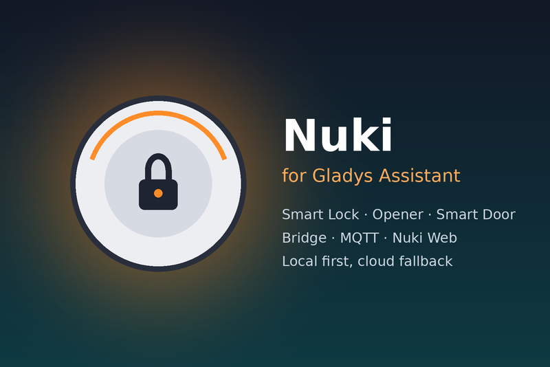

# Nuki for Gladys Assistant

External integration for [Gladys Assistant](https://gladysassistant.com) that brings the
whole **Nuki** range into Gladys: Smart Lock (1.0 to 4th generation, 3.0 Pro, Ultra),
Smart Door and Opener, with their accessories (door sensor, keypad, power pack).



It goes beyond the Nuki integration built into Gladys: three channels instead of two
(Nuki Bridge, MQTT **and** Nuki Web, combined with a local-first fallback), the Opener,
the door sensor and the keypad, scene triggers telling **who** operated the lock and
**how**, scene actions, and three dashboard widgets.

- **User documentation**: [English](docs/en.md) · [Français](docs/fr.md) ·
  [Deutsch](docs/de.md) · [Español](docs/es.md)
- **Requires** Gladys Assistant **5.1.0** or later.
- **Languages**: English, French, German, Spanish.
- **Transports**: `local` (Bridge HTTP API, MQTT) and `cloud` (Nuki Web).

## Features

| Area           | What you get                                                                                                                                               |
| -------------- | ---------------------------------------------------------------------------------------------------------------------------------------------------------- |
| Channels       | Nuki Bridge HTTP API (hashed token, request queue), Smart Lock MQTT API (push), Nuki Web API — local first, automatic fallback, transport badge per device |
| Smart Lock     | Lock switch, lock state, battery %, battery low, charging, door sensor (state + battery), keypad battery                                                   |
| Opener         | Ring to Open, continuous mode, battery low, doorbell ring                                                                                                  |
| Configuration  | “Find my Bridge” (Nuki discovery service), “Pair the Bridge” (press the button, the token is saved), connection test, refresh                              |
| Scene triggers | Lock operated (filter on operation, trigger — app, keypad, fingerprint, auto lock… — and Nuki user), doorbell rang, lock problem, battery critical         |
| Scene actions  | Operate a lock, operate an Opener, read a device (outputs for the next actions), lock every lock                                                           |
| Widgets        | Lock card (state, live battery, door, buttons), overview with “Lock all”, activity log (who / how / when)                                                  |

## How it works

```
index.js                     SDK bootstrap: create the client, wire it, connect
src/app.js                   SDK wiring: every handler (commands, actions, scenes, widgets, lifecycle)
src/hub.js                   the Nuki hub: channels, effective snapshot per device, local/cloud
                             preference and fallback, commands, states, transports, scene events
src/nuki/bridgeClient.js     Bridge HTTP API client (hashed token, one request at a time) + discovery
src/nuki/mqttClient.js       Smart Lock MQTT API client (nuki/<id>/#)
src/nuki/webClient.js        Nuki Web API client
src/nuki/normalize.js        Bridge / MQTT / Web payloads -> one snapshot format
src/nuki/constants.js        Nuki codes (states, actions, triggers, device types) and their mappings
src/devices.js               Gladys devices and states built from a snapshot
src/events.js                scene trigger detection (one event per transition)
src/scenes.js                scene actions
src/widgets.js               dashboard widgets
src/actions.js               Configuration screen buttons
src/history.js               activity history, saved to /data
src/i18n.js                  runtime texts in en / fr / de / es
src/config.js                defaults and normalization of the configuration
```

Every channel produces the same **snapshot** of a device, keyed by its 8-hex-digit Nuki ID
(the one MQTT topics use; the Bridge reports it in decimal, Nuki Web prefixes it with the
device type). The external ids are built from it, so a lock found through the Bridge, MQTT
or Nuki Web is the **same** Gladys device: switching channel keeps the history and the
scenes.

The hub reads the Bridge with its own timer (one `/list` call for every device, cached by
the Bridge, instead of one call per device) and Nuki Web only when needed (cloud preferred,
or a device no local channel reaches) and never faster than every 30 seconds; MQTT pushes.
States go through `publishChangedStates` (only what changed, plus a 30-minute heartbeat).

## Development

```bash
npm install
npm test               # node --test, against the fake Gladys of the SDK — no network
npm run lint
npm run format:check
```

Run it against a Gladys instance:

```bash
GLADYS_HOST_API_URL="http://localhost:1443" \
GLADYS_INTEGRATION_TOKEN="<token>" \
GLADYS_INTEGRATION_SELECTOR="nuki" \
DATA_DIR=./data LOG_LEVEL=debug \
npm start
```

Check the store rules before releasing: `npx github:GladysAssistant/integration-store .`

See [CLAUDE.md](CLAUDE.md) for the project rules (external ids, versions, changelog,
translations).

## Release

Describe the changes under `## [Unreleased]` in [CHANGELOG.md](CHANGELOG.md), then run
**Actions → Release** and pick `patch`, `minor` or `major`: the workflow bumps the
versions, tags, builds the `linux/amd64` + `linux/arm64` image to
`ghcr.io/gboulvin/gladys-nuki` and publishes the GitHub Release.

## Credits

Built from the official
[JavaScript integration template](https://github.com/GladysAssistant/integration-template-js)
and inspired by the Nuki service of the Gladys core. Not affiliated with Nuki Home
Solutions GmbH; “Nuki” is their trademark.

## License

Apache-2.0
